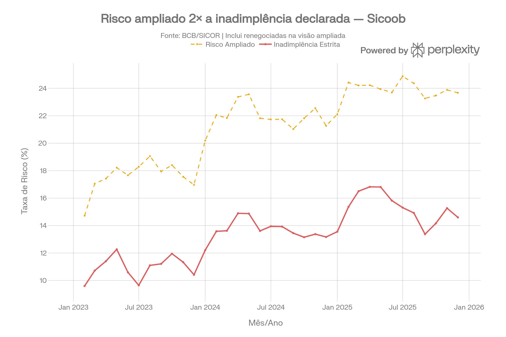

# case-sicor

Análise da carteira de **crédito rural** a partir dos microdados públicos do **SICOR** (Sistema de Operações do Crédito Rural e do Proagro — Banco Central do Brasil), com recorte para o **Sicoob** em comparação com o mercado.

O projeto consolida os microdados de operações e saldos de 2023 a 2025 numa base analítica em Parquet e calcula indicadores de inadimplência e de risco por modalidade, cultura, tipo de instituição financeira e UF.

## Principais resultados

| | |
|---|---|
| Contratos na base analítica | 3,2 milhões |
| Volume contratado | R$ 900,8 bilhões |
| Instituições financeiras | 429 |
| UFs cobertas | MT, MS, GO, DF, MG, PR, SP, RS, SC |
| Participação do Sicoob por tipo de IF | 34,2% (bancos públicos 28,2%, outras cooperativas 20,7%, bancos privados 17%) |

- O **risco ampliado** (inadimplência mais operações renegociadas) do Sicoob fica entre **1,6× e 2×** a inadimplência declarada ao longo de 2023–2025.
- Os gráficos estão em [`reports/figures/`](reports/figures/).



## Estrutura

```
case-sicor/
├── data/
│   ├── raw/
│   │   ├── tabelas_dominio/        # Tabelas de domínio do SICOR (versionadas)
│   │   └── *.gz                    # Microdados do BCB (não versionados — baixar)
│   ├── interim/                    # Parquets intermediários + DuckDB (gerados)
│   └── processed/
│       ├── base_analitica*.parquet # Base analítica (gerada)
│       └── serie_mensal_inadimplencia.csv
├── notebooks/
│   ├── gerar_base_dados.ipynb      # 1.0 — Ingestão e base analítica
│   └── analise_EDA.ipynb           # 2.0 — Roteiro da análise exploratória
├── reports/
│   └── figures/                    # Gráficos usados na apresentação
├── models/                         # Reservado para modelos
├── pyproject.toml
└── requirements.txt
```

## Dados

Os microdados brutos (~1,2 GB) e os artefatos gerados (~1,4 GB) **não estão no repositório**. Para reproduzir:

1. Baixe os arquivos do portal de [Tabelas do Crédito Rural e do Proagro do BCB](https://www.bcb.gov.br/estabilidadefinanceira/tabelas-credito-rural-proagro):
   - `SICOR_OPERACAO_BASICA_ESTADO_2023.gz`, `..._2024.gz`, `..._2025.gz`
   - `SICOR_SALDOS_2023.gz`, `..._2024.gz`, `..._2025.gz`
2. Coloque-os em `data/raw/`, sem descompactar (o DuckDB lê `.gz` diretamente).

As tabelas de domínio (`Empreendimento`, `Programa`, `SituacaoOperacao`, lista de IFs etc.) já estão em `data/raw/tabelas_dominio/`.

## Como executar

```bash
python -m venv .venv
# Windows: .venv\Scripts\activate  |  Linux/macOS: source .venv/bin/activate
pip install -r requirements.txt
jupyter lab
```

Execute `notebooks/gerar_base_dados.ipynb` do início ao fim. Ele gera:

| Arquivo | Conteúdo |
|---|---|
| `data/interim/operacoes.parquet` | Operações filtradas para as UFs foco (~3,2 mi linhas) |
| `data/interim/saldos.parquet` | Saldos mensais dessas operações (~39 mi linhas) |
| `data/processed/base_analitica.parquet` | Operações + domínios + último saldo + flags de risco |
| `data/processed/base_analitica_sample.parquet` | Amostra de 10% (seed 42) para exploração rápida |
| `data/processed/serie_mensal_inadimplencia.csv` | Série mensal de saldo e inadimplência (mercado × Sicoob) |

## Metodologia

**Pipeline:** DuckDB lê os `.gz` do BCB, filtra as UFs foco, materializa Parquets intermediários, cruza com as tabelas de domínio e associa a cada operação o **saldo mais recente** (`ROW_NUMBER` por `REF_BACEN`, `NU_ORDEM`).

**Classificação de risco** (a partir de `CD_SITUACAO_OPERACAO`):

| Nível | Códigos |
|---|---|
| `INADIMPLENTE_GRAVE` | 8 Desclassificada, 9 Baixada como prejuízo, 11 Inscrita em Dívida Ativa |
| `INADIMPLENTE` | 2 Em atraso, 12 Inadimplente, 13 Desclassificada parcialmente |
| `RENEGOCIADA` | 4, 5, 6 (renegociações com/sem nova operação) |
| `PRORROGADA` | 3 |
| `LIQUIDADA` | 7 |
| `NORMAL` | 1 |

- `FLAG_INADIMPLENTE` — códigos 2, 8, 9, 11, 12, 13 (visão estrita).
- `FLAG_RISCO_AMPLIADO` — visão estrita mais renegociadas (4, 5, 6).
- `FLAG_ATIVA` — exclui liquidadas e excluídas (7, 10); é o denominador das taxas.
- `LTV` — proxy de *loan-to-value*: `VL_PARC_CREDITO / VL_RECEITA_BRUTA_ESPERADA`.
- `VL_VENCIDO` — `max(VL_ULTIMO_DIA − VL_MEDIO_DIARIO_VINCENDO, 0)`.
- Sicoob é identificado pelo nome da IF na lista do SICOR; cooperativas pelo segmento.

## Limitações

- O notebook `analise_EDA.ipynb` contém apenas o roteiro da análise. Os gráficos em `reports/figures/` foram produzidos fora do repositório, a partir da base analítica e da série mensal.
- Os primeiros meses da série (dez/2022 e jan/2023) têm poucas operações e taxas distorcidas, porque a base parte de operações emitidas a partir de 2023.

## Autor

Pedro Boaventura
